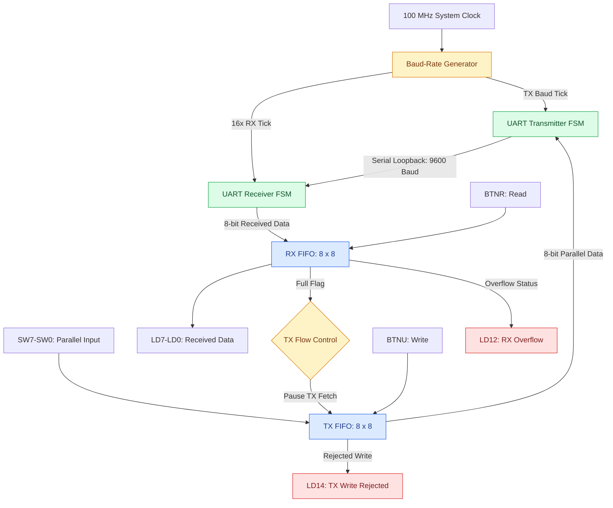
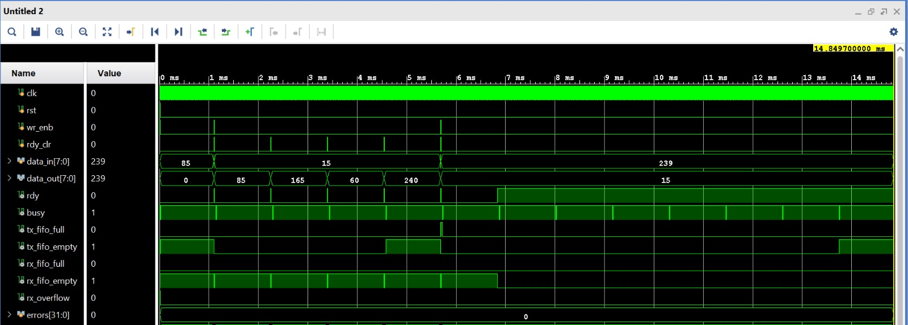

# FPGA-Based UART Communication System with Dual FIFO Buffering and Flow Control

**Verilog HDL | Xilinx Vivado 2018.3 | Digilent Basys 3 | Artix-7 FPGA**

## Overview

This project implements a UART (Universal Asynchronous Receiver-Transmitter) communication system with separate transmit (TX) and receive (RX) synchronous FIFO buffers, developed using Verilog HDL and implemented on the Digilent Basys 3 FPGA development board.

The system operates at **9600 baud with a 100 MHz system clock**, using **16× oversampling** for reliable UART reception. Each FIFO stores up to eight 8-bit data words, allowing parallel data transfers to be buffered independently of serial communication timing.

An internal TX-to-RX loopback is used to verify the complete data path. Flow-control logic pauses new UART transmissions when the RX FIFO is full, while status and error indicators provide visibility into buffer operation.

## Key Features

- FSM-based UART transmitter and receiver.
- Standard 8N1 UART framing: 1 start bit, 8 data bits, no parity, and 1 stop bit.
- 9600 baud communication.
- 16× oversampling at the UART receiver.
- Dual 8×8 synchronous FIFOs with full and empty detection.
- FIFO-based transmission flow control.
- Internal serial loopback for functional verification.
- Sticky TX write-rejection and RX overflow indicators.
- Debounced, single-pulse push-button inputs.
- FPGA hardware interface using switches, push buttons, and LEDs.
- Self-checking simulation testbench.

## System Architecture



### Transmit Path

1. The user sets an 8-bit data value using the FPGA switches.
2. Pressing BTNU generates a debounced write pulse.
3. The byte is stored in the TX FIFO if space is available.
4. The TX controller fetches a byte when the transmitter is idle and the RX FIFO is not full.
5. The UART transmitter serializes the byte, sending the start bit, eight data bits (LSB first), and stop bit.

### Receive Path

1. The transmitted serial signal is connected internally to the UART receiver.
2. The receiver detects the start bit and samples incoming data using 16× oversampling.
3. The reconstructed byte is written into the RX FIFO if space is available.
4. The RX FIFO retains the byte until a read is requested.
5. Pressing BTNR generates a read pulse and updates the output LEDs with the received byte.

## Design Specifications

| Parameter | Specification |
|---|---|
| FPGA Board | Digilent Basys 3 |
| FPGA Device | XC7A35T-1CPG236C |
| FPGA Family | Xilinx Artix-7 |
| System Clock | 100 MHz |
| UART Baud Rate | 9600 |
| Frame Format | 8N1 |
| RX Oversampling | 16× |
| TX FIFO | 8 entries × 8 bits |
| RX FIFO | 8 entries × 8 bits |
| RTL Language | Verilog HDL |
| Tool | Xilinx Vivado 2018.3 |

## RTL Modules

| File | Description |
|---|---|
| `baud_rate_generator.v` | Generates TX baud-rate and RX oversampling timing enables |
| `UART_TX.v` | FSM-based UART transmitter |
| `UART_RX.v` | UART receiver with 16× oversampling |
| `fifo_sync.v` | Synchronous FIFO with full/empty detection |
| `Top_Module.v` | Integrates TX/RX FIFOs, UART modules, loopback, and flow control |
| `button_one_pulse.v` | Synchronizes and debounces push-button inputs |
| `uart_fifo_basys3_top.v` | FPGA top module for Basys 3 hardware interfacing |

## FPGA Input and Output Mapping

### Input Controls

| FPGA Input | Function |
|---|---|
| SW0–SW7 | 8-bit input data |
| BTNU | Write byte into TX FIFO |
| BTNR | Read byte from RX FIFO |
| BTNC | Reset the system |

### LED Indicators

| LED | Function |
|---|---|
| LD0–LD7 | Last byte read from RX FIFO |
| LD8 | UART TX busy |
| LD9 | TX FIFO full |
| LD10 | RX FIFO empty |
| LD11 | RX FIFO full |
| LD12 | RX overflow (sticky) |
| LD13 | TX FIFO not empty |
| LD14 | TX write rejected (sticky) |

## FIFO Flow Control

The TX controller checks the RX FIFO full flag before fetching the next byte for transmission.

When the RX FIFO is full, the controller pauses additional transmissions. Once the system reads data from the RX FIFO, the controller can resume fetching queued bytes from the TX FIFO.

The design also includes two sticky error indicators:

- **TX Write Rejected:** Asserted when a write is attempted while the TX FIFO is full.
- **RX Overflow:** Asserted when a received byte arrives while the RX FIFO is full and cannot be stored.

Both indicators remain asserted until reset.

## Functional Verification

Functional simulation was performed using a self-checking Verilog testbench in Xilinx Vivado.

The testbench checks UART serial transmission, reception, and received-data correctness using multiple test vectors.

### Example Test Vectors

| Input (Hex) | Expected Output (Hex) |
|---|---|
| `0x55` | `0x55` |
| `0xA5` | `0xA5` |
| `0x3C` | `0x3C` |
| `0xF0` | `0xF0` |
| `0x0F` | `0x0F` |
| `0x12` | `0x12` |
| `0x34` | `0x34` |
| `0x56` | `0x56` |
| `0x78` | `0x78` |
| `0x9A` | `0x9A` |
| `0xBC` | `0xBC` |
| `0xDE` | `0xDE` |
| `0xEF` | `0xEF` |

**Recorded simulation result:** 13 checked UART frames with zero reported errors.

### Simulation Waveform



The waveform shows UART data transfer through the TX FIFO, serial transmitter, internal loopback, serial receiver, and RX FIFO. FIFO status and control signals can also be inspected to understand buffered communication.

## FPGA Implementation Results

The design was synthesized and implemented for the Xilinx Artix-7 XC7A35T-1CPG236C FPGA.

| Resource / Metric | Result |
|---|---:|
| Slice LUTs | 175 |
| Slice Registers | 283 |
| Occupied Slices | 94 |
| Bonded IOBs | 25 |
| BUFGCTRL | 1 |
| Timing-Closed Clock Constraint | 3.40 ns |
| Equivalent Constraint Frequency | 294.12 MHz |
| Setup WNS at 3.40 ns | +0.260 ns |
| Hold WHS at 3.40 ns | +0.159 ns |
| Setup Failing Endpoints | 0 |
| Estimated On-Chip Power | 77 mW |

**Timing clarification:** Timing closure at 3.40 ns demonstrates that the implemented design met that timing constraint. It does not establish a measured maximum operating frequency. Hardware testing uses the board's 100 MHz clock.

**Power clarification:** The 77 mW figure is a low-confidence Vivado power estimate rather than a measured power value.

## Repository Structure

```text
FPGA-UART-Dual-FIFO/
|
|-- README.md
|-- Top_Module.v
|-- UART_RX.v
|-- UART_TX.v
|-- UART_with_FIFO.xdc
|-- UART_with_fifo_tb.v
|-- Waveform_behav_sim_UART_FIFO.jpeg
|-- baud_rate_generator.v
|-- button_one_pulse.v
|-- fifo_sync.v
|-- uart_fifo_basys3_top.v
```

All source files are stored directly in the repository root.

## How to Run

### 1. Create the Vivado Project

Open Xilinx Vivado 2018.3 and create a new RTL project targeting the Basys 3 FPGA device:

`xc7a35tcpg236-1`

### 2. Add Design Sources

Add the following Verilog files under **Design Sources**:

- `Top_Module.v`
- `UART_TX.v`
- `UART_RX.v`
- `baud_rate_generator.v`
- `fifo_sync.v`
- `button_one_pulse.v`
- `uart_fifo_basys3_top.v`

Set `uart_fifo_basys3_top` as the synthesis top module for FPGA implementation.

### 3. Add Simulation Sources

Add `UART_with_fifo_tb.v` under **Simulation Sources**.

Set the testbench module declared in that file as the simulation top.

### 4. Run Behavioral Simulation

Select **Run Simulation → Run Behavioral Simulation**.

Inspect the following signals:

- `data_in`
- `wr_enb`
- `tx_fifo_full`
- `tx_fifo_empty`
- `busy`
- `rx_fifo_full`
- `rx_fifo_empty`
- `rdy_clr`
- `data_out`
- `rx_overflow`

### 5. Run FPGA Implementation

Add `UART_with_FIFO.xdc` under **Constraints**.

Run:

1. Synthesis
2. Implementation
3. Generate Bitstream
4. Open Hardware Manager
5. Program Device

### 6. Test on Basys 3

Set an input byte using SW0–SW7 and press BTNU to transmit it.

Once the byte has been received and stored in the RX FIFO, press BTNR to read it. The received value will appear on LD0–LD7.

The additional LEDs show UART and FIFO status.

## Learning Outcomes

This project demonstrates practical experience with:

- Verilog RTL design and modular hardware architecture.
- FSM-based serial communication.
- UART transmitter and receiver design.
- Synchronous FIFO buffering.
- Data-flow control and backpressure.
- UART timing and 16× oversampling.
- Self-checking testbench development.
- FPGA synthesis, implementation, and timing analysis.
- Hardware debugging using switches, buttons, and LEDs.

## Future Improvements

- External UART communication using FPGA serial I/O.
- Parameterized FIFO depth and baud-rate configuration.
- UART parity and framing-error detection.
- Expanded verification of FIFO-full, overflow, and recovery conditions.
- Activity-based FPGA power estimation.

---

**Keywords:** FPGA, UART, Verilog, RTL Design, FIFO, Flow Control, FSM, Artix-7, Basys 3, Xilinx Vivado, Digital VLSI
